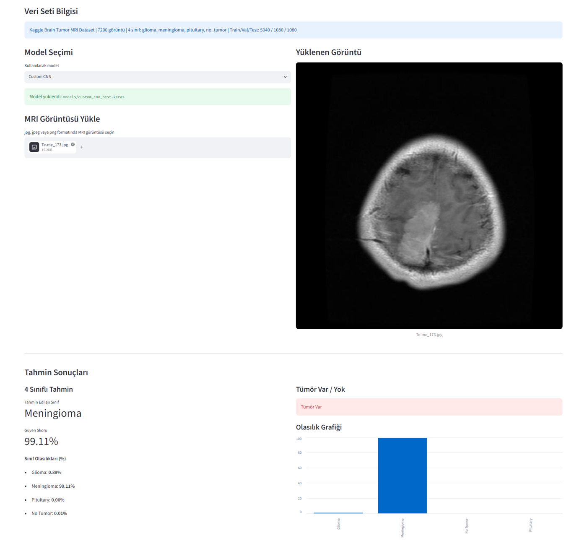
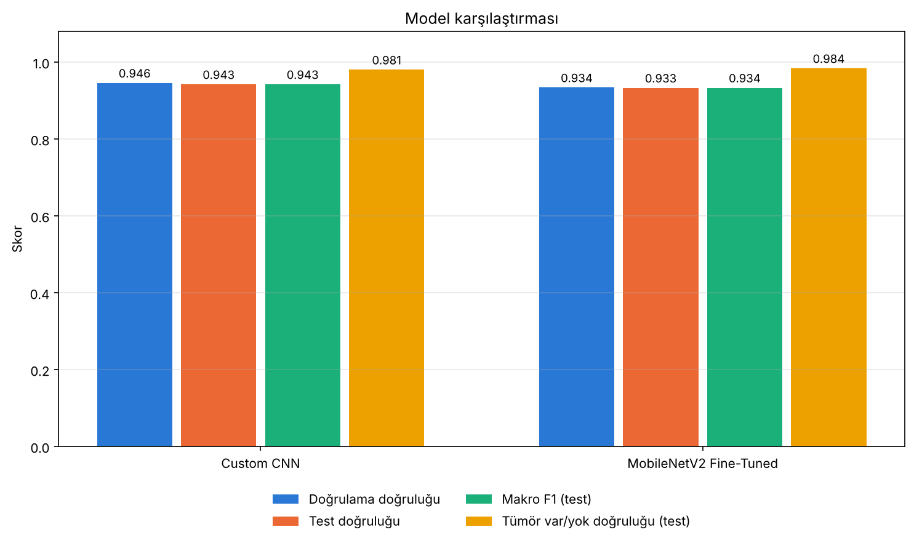
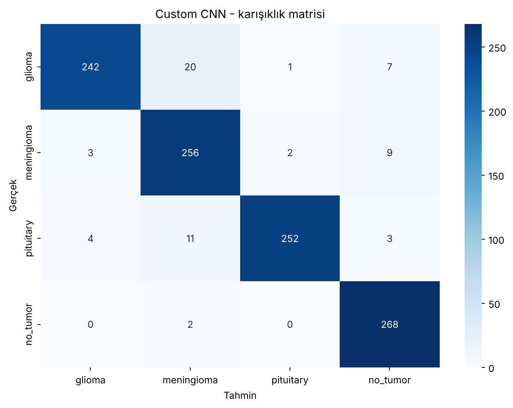
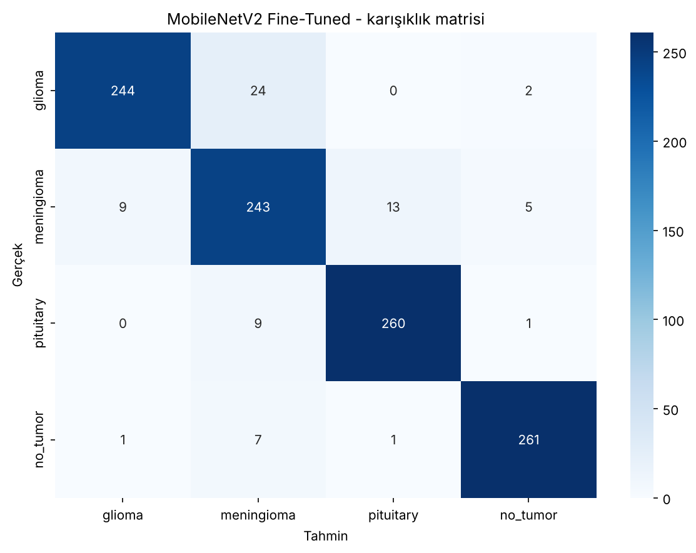
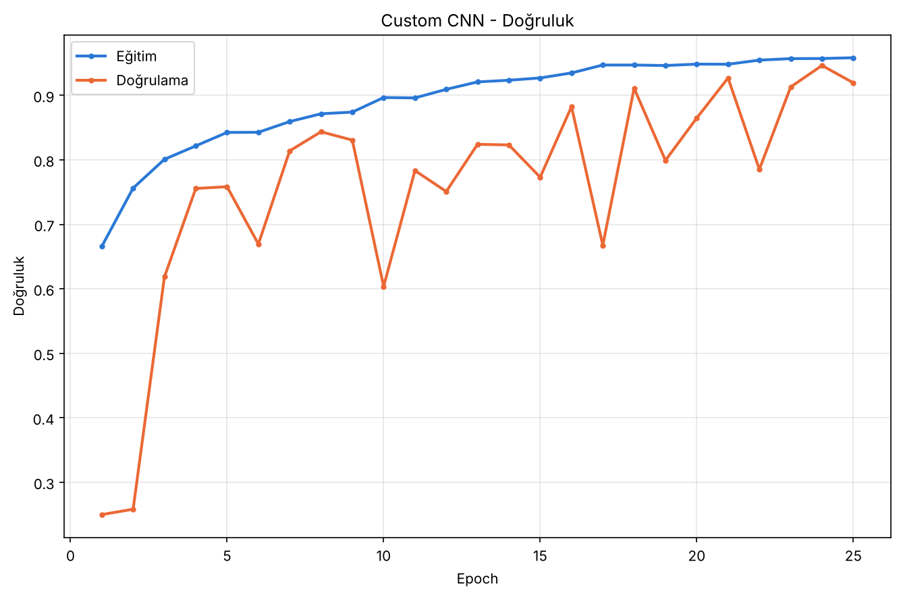

# MRI Görüntülerinden Beyin Tümörü Sınıflandırma

Beyin MRI görüntülerini dört sınıfa (glioma, meningioma, hipofiz tümörü, tümör
yok) ayıran bir derin öğrenme çalışması. Sıfırdan eğitilen küçük bir evrişimli
ağ ile transfer öğrenmeli MobileNetV2 karşılaştırılır; eğitilen modeller bir
Streamlit arayüzünden denenebilir. Örüntü Tanıma dersi dönem projesi olarak
geliştirildi.

> Bu bir ders projesidir. Tıbbi cihaz değildir; tanı ya da tedavi kararı için kullanılamaz.

## Özet

| | |
|---|---|
| Veri | Kaggle Brain Tumor MRI Dataset: 7.200 görüntü, 4 dengeli sınıf |
| Bölme | 5.040 eğitim / 1.080 doğrulama / 1.080 test (katmanlı) |
| Modeller | Custom CNN (457 bin parametre), MobileNetV2 ince ayar (2,26 milyon parametre) |
| Test doğruluğu (4 sınıf) | Custom CNN %94,3 · MobileNetV2 %93,3 (standart hata ±0,8 puan) |
| Tümör var/yok duyarlılığı | Custom CNN %97,7 · MobileNetV2 %99,0 |
| Arayüz | Streamlit: görüntü yükle, sınıf olasılıklarını ve tümör var/yok sonucunu gör |



*Arayüzün ilk sürümünden bir ekran görüntüsü; test setinden bir meningioma örneği.*

## Yöntem

**Veri hazırlığı.** Bozuk dosyalar ayıklanır, görüntüler sınıf oranları
korunarak %70 / %15 / %15 bölünür. Bölme `outputs/reports/` altındaki üç CSV
dosyasında kayıtlıdır; eğitim ve değerlendirme her zaman bu dosyaları okur.

**Ön işleme.** Görüntü RGB'ye çevrilip 224×224'e küçültülür, 3×3 Gauss
bulanıklaştırmayla hafifçe yumuşatılır ve ölçeklenir (Custom CNN için 0-1,
MobileNetV2 için -1 ile 1 arası). Eğitim, değerlendirme ve arayüz aynı
fonksiyonları kullanır (`src/preprocessing.py`).

**Veri artırma** yalnızca eğitim setinde: ±15° döndürme, %10 yakınlaştırma,
yatay çevirme, hafif parlaklık ve konum değişimi.

**Custom CNN.** 32, 64, 128 ve 256 filtreli dört evrişim bloğu (her birinde
BatchNormalization ve MaxPooling), ardından GlobalAveragePooling, 256 nöronlu
bir katman ve Dropout. Sıfırdan, Adam (5e-4) ile en fazla 25 epoch.

**MobileNetV2**, iki aşamada:

1. *Özellik çıkarımı:* ImageNet ağırlıklı taban dondurulur, yalnızca yeni
   sınıflandırıcı eğitilir (15 epoch). Doğrulama doğruluğu 0,873.
2. *İnce ayar:* tabanın son 25 katmanı (BatchNormalization hariç) 1e-5 öğrenme
   oranıyla eğitime açılır (10 epoch). Doğrulama doğruluğu 0,934.

Her eğitimde doğrulama doğruluğu en yüksek model saklanır; EarlyStopping ve
ReduceLROnPlateau kullanılır.

## Sonuçlar

Değerler, eğitimde hiç kullanılmayan 1.080 görüntülük test setinde ölçüldü.

| Model | Doğrulama doğruluğu | Test doğruluğu | Makro F1 | Parametre |
|---|---:|---:|---:|---:|
| Custom CNN | 0,946 | 0,943 | 0,943 | 457.156 |
| MobileNetV2 (ince ayar) | 0,934 | 0,933 | 0,934 | 2.263.108 |



Sınıf bazında F1:

| Sınıf | Custom CNN | MobileNetV2 |
|---|---:|---:|
| Glioma | 0,93 | 0,93 |
| Meningioma | 0,92 | 0,88 |
| Hipofiz tümörü | 0,96 | 0,96 |
| Tümör yok | 0,96 | 0,97 |

Dört sınıflı tahmin "tümör var / tümör yok" sorusuna indirgendiğinde:

| Model | Doğruluk | Duyarlılık | Özgüllük | Kaçırılan tümör | Yanlış alarm |
|---|---:|---:|---:|---:|---:|
| Custom CNN | 0,981 | 0,977 | 0,993 | 19 / 810 | 2 / 270 |
| MobileNetV2 (ince ayar) | 0,984 | 0,990 | 0,967 | 8 / 810 | 9 / 270 |

Nasıl okunmalı:

- **İki model dört sınıflı doğrulukta ayırt edilemiyor.** Aradaki fark 10
  görüntü (0,009); 1.080 görüntülük bir test setinde doğruluğun standart
  hatası yaklaşık 0,008. "Custom CNN daha iyi" demek için bu fark yeterli değil.
- **Asıl fark hata türünde.** MobileNetV2 daha az tümör kaçırıyor (8'e karşı
  19), Custom CNN daha az yanlış alarm veriyor (2'ye karşı 9). Tarama amaçlı
  bir kullanımda kaçırılan tümör daha pahalı bir hata olduğu için MobileNetV2
  tercih edilirdi.
- **En çok karışan çift glioma ile meningioma.** İki modelde de glioma
  görüntülerinin 20-24'ü meningioma olarak sınıflandırılıyor.
- Custom CNN, beşte bir parametreyle aynı düzeyde sonuç veriyor.

| Custom CNN | MobileNetV2 (ince ayar) |
|---|---|
|  |  |

### Eğitim notu

Custom CNN eğitimi sırasında bir hata oldu ve bu depodaki kayıtlar onu
düzeltilmiş hâliyle yansıtıyor. Eğitim 9. epoch'tayken, son checkpoint'ten
devam eden ikinci bir eğitim süreci başlatıldı; ilk süreç de çalışmaya devam
ediyordu. İki süreç aynı checkpoint dosyalarına yazdı. İlk süreç 0,966
doğrulama doğruluğuna ulaşan bir model kaydetti, ancak ikinci süreç 18 dakika
sonra kendi en iyi modelini (0,946) aynı dosyanın üzerine yazdı.

Sonuç olarak `models/custom_cnn_best.keras`, ikinci sürecin 24. epoch'undaki
modeldir. Test sonuçları bu dosyayla ölçüldüğü için geçerlidir; ona ait
doğrulama doğruluğu ise 0,966 değil 0,946'dır. Buradaki eğitim eğrileri ve
tablolar kayıtlı modelin kendi geçmişini gösterir. İki sürecin ham kayıtları
`outputs/reports/custom_cnn_epoch_log.txt` dosyasında iç içe durmaktadır.



Eğri ayrıca şunu gösteriyor: bu süreçte öğrenme oranı hiç düşmedi ve doğrulama
doğruluğu epoch'tan epoch'a 0,60 ile 0,95 arasında oynadı. Kayıtlı model bir
tepe noktasında alınmış; eğitim kararlı değil.

Aynı hatanın tekrarlanmaması için eğitim akışı değiştirildi (`src/train.py`):
aynı model için ikinci bir süreç başlatılamıyor, devam eden bir eğitim daha
önceki en iyi sonucu geçmeden "en iyi" modelin üzerine yazamıyor ve önceki
kayıtlar varken ne yapılacağı (`--resume` ya da `--fresh`) açıkça belirtilmek
zorunda.

## Sınırlamalar

- **Tek bir bölme.** Çapraz doğrulama yapılmadı; sonuçlar tek bir test
  setine dayanıyor ve ±0,8 puanlık bir belirsizlik taşıyor.
- **Kümeler arası sızıntı olabilir.** Veri setinde hasta kimliği yok. Aynı
  hastanın komşu kesitleri ya da aynı görüntünün kopyaları hem eğitim hem test
  kümesine düşmüş olabilir; bu, test başarısını olduğundan yüksek gösterir.
  `scripts/check_duplicates.py` bayt bayt aynı dosyaları bulur, komşu kesitleri bulamaz.
- **Resmî bölme kullanılmadı.** Veri setinin Training ve Testing klasörleri
  birleştirilip yeniden bölündü. Sonuçlar, resmî test klasörünü kullanan
  çalışmalarla doğrudan karşılaştırılamaz.
- **Tek veri kaynağı.** Başka cihaz ya da hastanelerden gelen görüntülerde
  modelin nasıl davranacağı ölçülmedi.
- **Hiperparametre araması yapılmadı.** Mimari ve öğrenme oranları elle seçildi.

## Çalıştırma

Python 3.12 ile geliştirildi.

```bash
python -m venv .venv
source .venv/bin/activate          # Windows: .venv\Scripts\activate
pip install -r requirements.txt
```

Arayüzü denemek için veri setine gerek yoktur; iki eğitilmiş model depodadır:

```bash
streamlit run app/streamlit_app.py
```

Testler TensorFlow ve veri seti gerektirmez:

```bash
python -m unittest discover -s tests
```

Eğitimi ve değerlendirmeyi yeniden çalıştırmak için veri seti
[`data/README.md`](data/README.md) dosyasında anlatıldığı gibi yerleştirilmelidir:

```bash
python scripts/check_duplicates.py      # kümeler arasında aynı görüntü var mı
python scripts/train_custom_cnn.py      # Custom CNN
python scripts/train_mobilenet.py       # MobileNetV2, 1. aşama
python scripts/finetune_mobilenet.py    # MobileNetV2, 2. aşama
python scripts/run_evaluation.py        # test seti raporları ve grafikleri
```

Eğitim scriptleri, önceki bir eğitimin kayıtları varsa `--resume` (kaldığı
yerden devam) ya da `--fresh` (baştan) seçeneği ister.

## Proje yapısı

```
config.py              ayarlar: yollar, sınıflar, eğitim parametreleri
src/
├── dataset.py         veri tarama, bölme, yinelenen görüntü denetimi
├── preprocessing.py   yükleme, gürültü azaltma, ölçekleme
├── augmentation.py    veri artırma ayarları
├── data_loader.py     Keras veri üreteçleri
├── models.py          Custom CNN ve MobileNetV2
├── train.py           eğitim akışı: kilit, devam etme, checkpoint, özet
├── evaluate.py        metrikler ve model karşılaştırması
├── predict.py         tek görüntü tahmini
└── plots.py           grafikler
scripts/               veri hazırlığı, eğitim ve değerlendirme komutları
app/streamlit_app.py   arayüz
tests/                 TensorFlow gerektirmeyen birim testleri
models/                eğitilmiş iki model (.keras)
outputs/               bölme dosyaları, eğitim kayıtları, raporlar, grafikler
```
